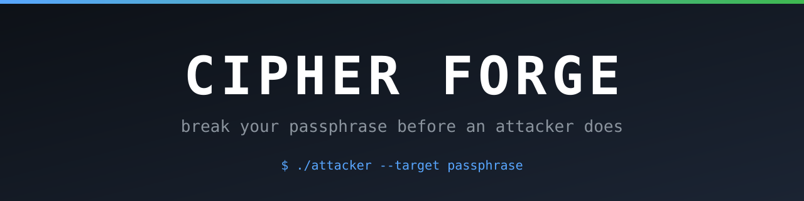

<p align="center">
  
</p>

<h2 align="left">By Darsh Vora</h2>

<p align="center">
  
  
  
  
</p>

<p align="center">
  <i>A password checker that tries to break your passphrase the way an attacker would, then tells you how it went.</i>
</p>

---

## Overview

Most password checkers give you a score and a colour. Cipher Forge goes further. It runs a three-stage attack on your passphrase and tells you which stage broke it, or how long it would take to guess if it survived.

The project has four parts:

- A **scoring** function that rates a passphrase from 0 to 100.
- A **staged attacker** that tries a dictionary, then common patterns, then estimates brute-force time.
- A small **pattern model** that judges how word-like a passphrase looks.
- A **benchmark** that compares the attacker with a simple common checker on 26 labelled passphrases.

It also has a generator that suggests passphrases that survive the same attack, and a C version of the attacker that runs in the terminal.

## Access it through

 https://darsh-sudo-cloud.github.io/Cipher-forge/

## Project structure

```
passphrase-forge/
├── index.html        Web page: the cards, timing bars, and comparison table
├── test.html         Test page that prints results to the console
├── scoring.js        Scores a passphrase from 0 to 100
├── attacker.js       Three-stage attack, time estimates, attack speeds
├── model.js          Pattern Sense: a small character-pair model
├── benchmark.js      The 26 labelled passphrases (the answer key)
├── baseline.js       A simple common checker, used for comparison
├── attacker.c        The same attack written in C, for the terminal
├── generate.py       Suggests passphrases from the word list
├── wordlist.txt      Words used to build suggestions
├── banner.svg        Banner image for this README
└── LICENSE           MIT License
```

## Features

- **Scoring:** length, character variety, and penalties for common endings and repeated characters.
- **Staged attack:** stage 1 checks common words, stage 2 undoes common tricks and checks endings, and stage 3 estimates brute-force effort.
- **Time estimates:** three assumed attack speeds, from online login attempts to a GPU rig, shown as bars.
- **Pattern Sense:** a model trained on a short word list. It judges how word-like a passphrase looks, ignoring digits and symbols.
- **Suggestions:** the Suggest button only offers passphrases that survive the attack.
- **Benchmark table:** 26 labelled passphrases, with the attacker and the common checker compared, paged 8 rows at a time.
- **Two versions:** the browser and the C terminal version run the same attack logic.

## How to run it

**Web page:** open `index.html` in a browser, or use the VS Code Live Server extension.

**C version (Windows, with MSYS2 gcc):**

```
gcc attacker.c -o attacker.exe -lm
.\attacker.exe 'Tiger-River-Moon-42'
```

**Suggestion generator (Python):**

```
python generate.py
```

## Testing

`benchmark.js` holds 26 passphrases, each with the result I expected from the rules, written down before I checked them. The page runs both checkers on every entry and shows the results.

On this set, the attacker matched all 26 expected results. The common checker matched 6 of 14 on the first set, and it is shown alongside the attacker on the page. The most useful case is `Tiger-River-Moon-42`: the common checker accepts it, but the attacker breaks it at stage 1.

Some expected results were corrected after my first check, because my intuition about what looked weak did not match the rules. That correction is part of the story, and I've kept the original intuitions in my notes.

## Limitations

- The word list is short (19 words). A real attacker uses lists with millions of entries, so the attack is only as good as its list.
- The brute-force time assumes fixed attack speeds and a fixed character pool. Real attackers differ, so the times are estimates.
- Stage 2 undoes only a few tricks. It does not handle keyboard patterns or dates in every format.
- Pattern Sense is trained on a small list of words, and it ignores digits and symbols. Its thresholds were set from a few examples, not a large test.
- The score and the attack are separate checks. A passphrase can score well and still break at stage 1, so the verdict is the more reliable result.
- The benchmark is small and was written by me, so it shows the logic is consistent, not that it is correct in every case.

## What I learned

- How password strength depends on predictable patterns, not just length and symbols.
- Why a verdict built from rules is easier to explain than a single score.
- How a small statistical model learns from data, and why its thresholds need testing.
- How writing expected results before testing keeps a comparison honest.
- How to keep two versions of the same logic (JavaScript and C) in agreement.

## Development notes

I built this to learn. I used an AI assistant to talk through the design, get
concepts like character-pair models and staged attacks explained, and debug
build errors. I decided what the results should look like, ran and tested each
part myself, and read through the code. I'm still working through some of the
details and will keep going back over them. 

## License

Released under the [MIT License](LICENSE).
